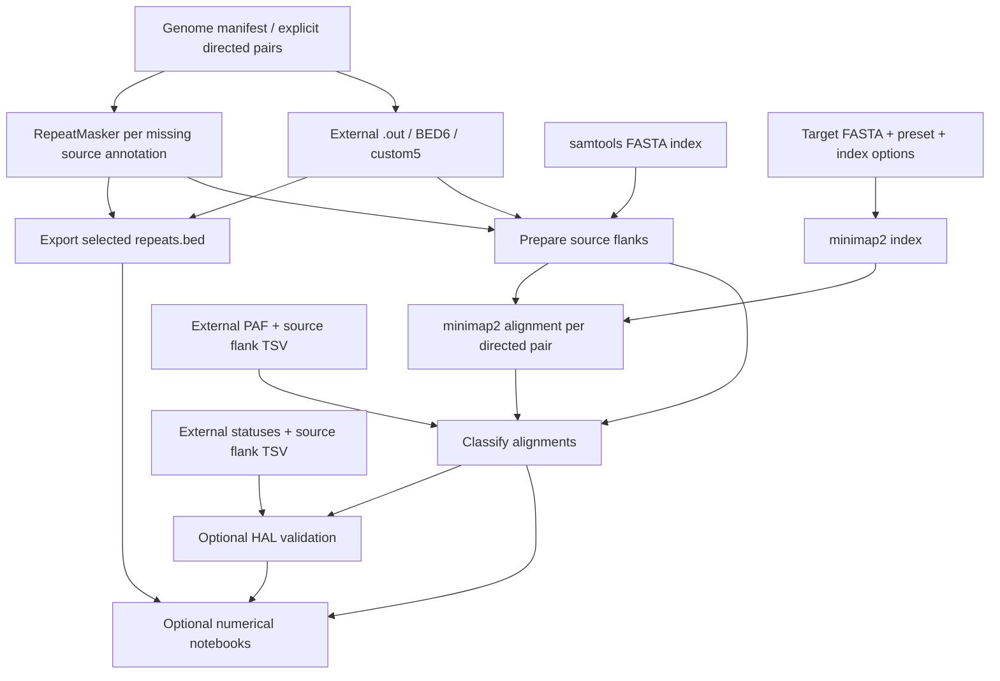

# ComRepka — Compare repeats

[English version](README.md)

ComRepka — пайплайн сравнительной геномики для исследования локусов повторяющихся элементов в собранных геномах. Он извлекает фланки повторов из исходного генома, выравнивает их на целевой геном с помощью minimap2 и классифицирует соответствия существующими Python-алгоритмами. Nextflow DSL2 управляет выполнением и сохраняет параметры и результаты анализа.

Основной путь: **FASTA → RepeatMasker → аннотация повторов и фланки → minimap2 → сравнительная таблица статусов**. Также можно использовать готовые аннотации, фланки или PAF. Геномы и направленные пары source–target задаются явно; применение не ограничено человеком, приматами или LTR.

**Воспроизводимость:** полный локальный workflow на фрагменте 20 kb сохранён вместе с выходными данными для samtools 1.22.1 и minimap2 2.22. В текущем окружении указаны samtools 1.25 и minimap2 2.31. Исторические результаты и версии программ описаны в разделе [Проверки и воспроизводимость](#проверки-и-воспроизводимость).

## Содержание

- [Установка](#установка)
- [Быстрый старт](#быстрый-старт)
- [RepeatMasker и базы повторов](#repeatmasker-и-базы-повторов)
- [Полное и частичное выполнение](#полное-и-частичное-выполнение)
- [Входы и форматы](#входы-и-форматы)
- [Параметры](#параметры)
- [Выходы и интерпретация](#выходы-и-интерпретация)
- [SLURM и ресурсы](#slurm-и-ресурсы)
- [Notebooks](#notebooks)
- [Примеры данных](#примеры-данных)
- [Архитектура](#архитектура)
- [Проверки и воспроизводимость](#проверки-и-воспроизводимость)
- [Лицензия и цитирование](#лицензия-и-цитирование)

## Установка

Документированная платформа — Linux x86_64, Bash, Conda, **Nextflow 25.10.2** и **OpenJDK 17.0.18**. Java нужна для Nextflow; научные скрипты написаны на Python. Conda устанавливается по [инструкции Bioconda](https://bioconda.github.io/). Для отдельной установки Nextflow доступна [официальная инструкция](https://docs.seqera.io/nextflow/install/).

Команды ниже выполняются из корня репозитория. Уже установленный Nextflow можно использовать без переустановки. Чтобы восстановить сохранённое окружение запуска на Linux x86_64:

```bash
conda create --prefix "$PWD/.conda/nextflow" --file envs/locked/linux-64/nextflow.explicit.txt
conda activate "$PWD/.conda/nextflow"
```

Профили `local` и `slurm` включают Conda. Nextflow сам создаёт и активирует окружения для выбранных этапов; устанавливать их по одному не требуется. Базы повторов предоставляются отдельно, как описано ниже. [Документация Nextflow о Conda](https://docs.seqera.io/nextflow/conda).

| Спецификация | Основные инструменты | Назначение |
|---|---|---|
| [envs/core.yml](envs/core.yml) | Python 3.12.2, pandas 2.2.1, NumPy 1.26.4, tqdm 4.65.0, samtools 1.25, minimap2 2.31 | Основное вычислительное окружение |
| [envs/repeatmasker.yml](envs/repeatmasker.yml) | RepeatMasker 4.2.3, HMMER 3.3.2; TRF входит в зависимости пакета | Аннотация повторов |
| [envs/analysis.yml](envs/analysis.yml) | Python/pandas/NumPy, PyTables, JupyterLab, ipykernel | Анализ в ноутбуках |

Полный запуск теперь использует **два окружения процессов**: `core` для Python, samtools и minimap2 и `repeatmasker` для аннотации повторов. `analysis` необязателен и устанавливается вручную для notebooks; окружение запуска Nextflow отдельно. Python- и minimap-процессы ссылаются на один `envs/core.yml`, поэтому Nextflow переиспользует для них общее окружение.

На 2026-11-19 последние релизы — [samtools 1.25](https://github.com/samtools/samtools/releases/tag/1.25) и [minimap2 2.31](https://github.com/lh3/minimap2/releases/tag/v2.31). Их опубликованные сборки Bioconda для Linux x86_64 (`samtools-1.25-h9dcdb79_0`, `minimap2-2.31-h118bc1c_0`) требуют одинаковые `libzlib >=1.3.2,<2.0a0`, `libgcc >=14` и glibc >=2.17. Прежнего конфликта диапазонов zlib нет. Metadata пакетов: [samtools](https://api.anaconda.org/release/bioconda/samtools/1.25), [minimap2](https://api.anaconda.org/release/bioconda/minimap2/2.31). Версии самих инструментов закреплены для воспроизводимости; номера сборок и zlib вручную не закрепляются. Версии Python-пакетов сохранены. Для каждого анализа сохраняйте фактический список разрешённых пакетов и их версий.

Снимки пакетов **baseline от 2026-11-17** сохранены в [envs/locked/linux-64](envs/locked/linux-64). `core.explicit.txt` и `minimap2.explicit.txt` описывают прежние раздельные окружения и оставлены только как история проверки; workflow их не использует. Снимки Nextflow и RepeatMasker также сохранены. Конфигурация, возвращавшая прежнее разделение, удалена. Для текущего объединённого core используйте `envs/core.yml`; исторические explicit-списки относятся к предыдущим окружениям. Базы данных предоставляются отдельно.

Управляйте `PATH` обычной активацией Conda: не добавляйте `bin` базового окружения перед активным окружением. Если Nextflow находится отдельно, вызывайте его по абсолютному пути и при необходимости задайте `NXF_JAVA_HOME` для его Java. Общий `--conda_cache /absolute/path` позволяет переиспользовать окружения между запусками. Образ Apptainer не включён.

## Быстрый старт

Этот небольшой пример использует готовый PAF и запускает только классификатор. RepeatMasker, загрузка Dfam и запуск minimap2 не нужны:

```bash
nextflow run main.nf -profile local \
  --genomes examples/genomes.tsv --pairs examples/pairs.tsv \
  --from paf --until statuses --outdir results/example-paf
```

Результат: `results/example-paf/pairs/genome_A__to__genome_B/statuses.tsv`. Сравните соответствующие поля с [examples/expected/classification_summary.tsv](examples/expected/classification_summary.tsv): два occupied-локуса и один локус без предоставленных выравниваний. Для получения фланков из имеющегося BED6:

```bash
nextflow run main.nf -profile local \
  --genomes examples/genomes.tsv --pairs examples/pairs.tsv \
  --from annotation --until flanks --outdir results/example-flanks
```

Эти примеры уже использовались в регрессионных проверках. Отдельный [пример полного workflow](#примеры-данных) содержит реальную последовательность, на которой проверяли RepeatMasker и всю цепочку.

## RepeatMasker и базы повторов

**Установка программы** и **источник базы** выбираются независимо. ComRepka никогда не загружает Dfam автоматически. Запуск с BED, `.out`, фланков или PAF не требует RepeatMasker и загрузки Dfam. Для аннотации исходного FASTA по species нужна совместимая установленная база.

### А. Настройка с нуля

Nextflow установит RepeatMasker и зависимости из `envs/repeatmasker.yml`, когда геному потребуется аннотация. При этом пути отдельная установка TRF и редактирование `RepeatMaskerConfig.pm` не требуются.

Если совместимые файлы Dfam уже есть, используйте их и пропустите загрузку. Иначе следующий **необязательный блок загрузки** подготовит Dfam 3.9 для млекопитающих: root partition 0 и Mammalia partition 7 из [конкретного релиза Dfam](https://www.dfam.org/releases/Dfam_3.9/families/FamDB/). Для других организмов нужны partitions из [таблицы этого релиза](https://www.dfam.org/releases/Dfam_3.9/families/FamDB/README.txt). Не смешивайте релизы и не заменяйте адрес на `current`, если воспроизводите эти результаты.

Укажите абсолютный путь без пробелов вне репозитория. Два архива занимают около 8.9 GB, распакованные файлы — около 60.4 GB; для хранения обоих вариантов нужно около 70 GB без учёта поисковых кешей. Блок остановится, если файлы базы уже существуют, вместо их перезаписи.

```bash
export COMREPKA_LIBDIR=/absolute/path/to/Dfam_3.9/Libraries
(
  set -euo pipefail
  mkdir -p "$COMREPKA_LIBDIR/famdb"
  cd "$COMREPKA_LIBDIR/famdb"
  for part in 0 7; do
    archive="dfam39_full.${part}.h5.gz"
    test ! -e "$archive"
    test ! -e "${archive%.gz}"
    curl --fail --location --retry 3 \
      --output "$archive" \
      "https://www.dfam.org/releases/Dfam_3.9/families/FamDB/$archive"
    curl --fail --location --retry 3 \
      --output "$archive.md5" \
      "https://www.dfam.org/releases/Dfam_3.9/families/FamDB/$archive.md5"
    md5sum -c "$archive.md5"
    gzip -dk "$archive"
  done
)
```

Сохраните следующий YAML как **`reference.yml`**, заменив путь. `-libdir` указывает на **`Libraries`**, родительский каталог `famdb`, а не на файл `.h5`. RepeatMasker 4.2.3 использует находящиеся там FamDB-файлы и создаёт поисковые кеши по мере необходимости; каталог должен быть доступен для записи. Разные релизы базы храните отдельно.

```yaml
rm_engine: hmmer
rm_sensitivity: s
rm_reference_id: Dfam-3.9_2025-03-10_curated_partitions-0-7
rm_extra_args: ["-libdir", "/absolute/path/to/Dfam_3.9/Libraries"]
```

Существующая персональная установка RepeatMasker для этого пути не нужна. В сохранённом полном примере использованы partitions Dfam 3.9 и отдельный каталог поискового кеша.

### Б. Использование уже настроенного RepeatMasker

Если программа и необходимая база уже доступны, установка и скачивание не нужны. Выберите **один** из следующих вариантов и сохраните его как **`site.config`**.

Для RepeatMasker в готовом **Conda-окружении** укажите абсолютный prefix окружения, а не его имя или путь к `bin/RepeatMasker`:

```groovy
process {
    withName: 'COMPARISON:REPEATMASKER' {
        conda = '/absolute/path/to/existing/repeatmasker-env'
    }
}
```

Nextflow активирует это окружение для RepeatMasker, продолжая управлять общим core-окружением для Python, samtools и minimap2. В указанном prefix должен находиться рабочий RepeatMasker с engine, TRF, Perl и зависимостями FamDB.

Для настроенной установки **вне Conda** отключите Conda только у этого процесса и задайте точный каталог executable:

```groovy
process {
    withName: 'COMPARISON:REPEATMASKER' {
        conda = null
        beforeScript = '''
        export PATH="/absolute/path/to/RepeatMasker:/absolute/path/to/hmmer/bin:$PATH"
        test "$(command -v RepeatMasker)" = "/absolute/path/to/RepeatMasker/RepeatMasker"
        '''
    }
}
```

Замените оба вхождения каталога RepeatMasker и каталог engine. Выбранная установка уже должна работать в этой оболочке со всеми Perl/Python-зависимостями и настроенным TRF executable. Если необходим environment module, добавьте обычный для вашего кластера `module load` в `beforeScript`. `TRF.pm` — Perl-модуль, а не native TRF executable: его нельзя указывать в `TRF_PRGM`. Глобально отключать Conda у остальных процессов не требуется.

Существующую настроенную библиотеку можно использовать с `rm_extra_args: []`. Другой вариант — указать её каталог `Libraries` в `reference.yml` через `-libdir`, как в пути А. В `rm_reference_id` запишите **реальный** релиз и набор partitions. Это поле фиксирует идентичность базы и влияет на кеш; оно не скачивает и не проверяет базу. Добавьте `-c site.config` в команду запуска. Это штатные настройки Nextflow; используйте пути и библиотеки, соответствующие своей установке.

### Общие настройки и проверка выбора

Проверенная конфигурация: RepeatMasker **4.2.3**, **HMMER 3.3.2**, `-engine hmmer -s -align`, Dfam **3.9 / 2025-03-10**, partitions **0 + 7**, curated families. Версия native TRF в проверенном Conda-окружении — **4.10.0rc2**. `species` берётся из строки соответствующего генома; полный пример использует `Homo sapiens`. Исторические команды содержали `-pa 48`; это не равно текущему числу выделяемых CPU по умолчанию (см. ресурсы).

`rm_library` выбирает пользовательскую библиотеку вместо `species`. Формат должен соответствовать engine: HMM-модели для HMMER, nucleotide consensus FASTA для RMBlast. Этот вариант может требовать дополнительной настройки engine и не является неявной заменой конфигурации Dfam/HMMER.

После запуска смотрите `genomes/<id>/repeatmasker/software_versions.txt` и `run.log`: там указаны фактические версия, engine и база. Эффективные параметры находятся в provenance `parameters.json`. Для готовой установки сохраняйте сведения об окружении или `site.config` вместе с результатами. Не заменяйте базу по прежнему пути в расчёте на автоматическое обнаружение изменения через `-resume`.

## Полное и частичное выполнение

Для полного анализа подготовьте свои `genomes.tsv` и `pairs.tsv`. Оставьте поля аннотации пустыми для геномов, которым нужен RepeatMasker. С `reference.yml` из пути А:

```bash
nextflow run main.nf -profile local -params-file reference.yml \
  --genomes genomes.tsv --pairs pairs.tsv \
  --from genome --until statuses --outdir results/study-001
```

Для пути Б добавьте `-c site.config`: это выберет готовый RepeatMasker, а остальные процессы будут использовать общий `envs/core.yml`. Для SLURM замените `-profile local` на `-profile slurm` и задайте параметры кластера.

Исходный `examples/genomes.tsv` уже содержит BED: `--from genome` с этим manifest **переиспользует аннотацию** и не проверяет RepeatMasker. Полный путь из FASTA представлен в `examples/full`. Аннотация target не нужна основному классификатору; `--annotate_targets true` при старте с `genome` или `annotation` также подготовит её для последующего сопоставления повторов. Все направленные пары перечисляются явно; self-pairs отклоняются.

| Старт (`--from`) | Необходимые готовые входы | Последующая работа |
|---|---|---|
| `genome` | Source FASTA и species/reference; target FASTA для выравнивания | Недостающая аннотация, BED, индекс, фланки, выравнивание, классификация |
| `annotation` | Source `.out`, BED6 или `custom5`; source FASTA для фланков; target FASTA для выравнивания | Экспорт BED и выбранные последующие этапы |
| `flanks` | Source flank FASTA и TSV; target FASTA | Выравнивание и классификация |
| `paf` | PAF каждой пары и source flank TSV | Классификация; genomic FASTA не требуется |
| `statuses` | Status TSV каждой пары и source flank TSV | Необязательный HAL; укажите `--until validation` |

Конечные этапы: `annotation`, `flanks`, `paf`, `statuses`, `validation`. Выбранный диапазон должен содержать работу; одинаковые начало/конец `flanks`, `paf` или `statuses` отклоняются. Наличие пути к intermediate в manifest не выбирает стартовый этап: укажите `--from`. При старте с `genome` можно смешивать готовые аннотации и геномы, требующие аннотации. При старте с `paf` или `statuses` соответствующий intermediate нужен каждой выбранной паре.

Чтобы продолжить запуск, повторите его команду с **`-resume`**, сохранив `.nextflow/cache` в каталоге запуска и каталог `work/`. Это переиспользование совпадающих задач, а не импорт произвольных опубликованных файлов. Для внешних результатов используются `--from` и поля manifests. [Документация кеша Nextflow](https://docs.seqera.io/nextflow/cache-and-resume/).

Python-скрипты также можно запускать отдельно:

```bash
python bin/prepare_repeat_annotation.py --input repeats.out --format rm_out \
  --target-groups LTR --output repeats.bed
samtools faidx genome.fa
python bin/prepare_flanks.py --bed repeats.bed --bed-format bed6 \
  --genome-fasta genome.fa --out-fasta flanks.fa --out-table flanks.tsv \
  --out-targets targets.tsv
python bin/classify_alignments.py --paf alignments.paf --flank-table flanks.tsv \
  --out-table statuses.tsv --mode stream
```

Это команды пути через BED. Для эквивалентности полному пути RepeatMasker передавайте полный `.out` в `prepare_flanks.py --rm-out repeats.out` с теми же selectors: отфильтрованный BED не сохраняет полную маску повторов. Самостоятельный `samtools faidx` создаёт соседний `.fai`; при необходимости используйте доступную для записи копию FASTA. Nextflow создаёт индекс в рабочем каталоге.

## Входы и форматы

Manifests — UTF-8 TSV с заголовком, разделителями tab и пустыми необязательными полями, без embedded tabs/newlines и CSV quoting. Workflow пропускает пустые строки и строки с начальным `#`; для совместимости с notebooks не добавляйте их. **Пути данных относительны к содержащему их manifest** либо абсолютны. Пути CLI/parameter file относительны к каталогу запуска. Все заполненные пути должны существовать, включая необязательные поля. Не помещайте credentials в manifests или параметры: они сохраняются в provenance.

Поля `examples/genomes.tsv`:

| Поле | Значение |
|---|---|
| `genome_id` | Уникальный идентификатор по шаблону `[A-Za-z][A-Za-z0-9_]*` |
| `fasta` | Несжатый genomic FASTA; contig IDs должны совпадать с аннотацией или chromosome map |
| `species` | Species selector RepeatMasker; не нужен при custom library или готовой аннотации |
| `annotation` | Один файл внешней аннотации повторов |
| `annotation_format` | Явно `rm_out`, `bed6` либо `custom5` |
| `flank_fasta` | Готовые queries с описанными ниже именами |
| `flank_table` | Соответствующий source-coordinate TSV |
| `chrom_map` | Необязательный JSON object: имена contigs аннотации → имена FASTA |

Поля `examples/pairs.tsv`:

| Поле | Значение |
|---|---|
| `source`, `target` | Genome IDs; направление source queries → target genome; дубликаты/self-pairs запрещены |
| `preset` | Preset minimap2 для пары; пустое поле использует `minimap_preset` |
| `paf` | Внешний PAF для `--from paf` |
| `statuses` | Внешний classifier TSV для `--from statuses` |
| `hal` | HAL alignment для необязательной валидации |
| `hal_source`, `hal_target` | Точные имена геномов внутри HAL |
| `hal_source_chrom_map`, `hal_target_chrom_map` | JSON maps source/predicted target contig names → HAL names |

Chromosome map — JSON object, например `{"old_contig": "new_contig"}`. Замена имён не делает координатный lift-over. Версии assemblies, последовательности и системы координат уже должны соответствовать друг другу.

**BED6**: `chrom start end name score strand`, tab-separated, без заголовка. Координаты 0-based half-open; `name` — имя повтора; `score` — integer 0–1000 (при экспорте `0`, вычислительно не используется); `strand` — `+`, `-` или `.`. Это соответствует [спецификации UCSC BED](https://genome.ucsc.edu/FAQ/FAQformat.html#format1). Принимаются ровно шесть колонок; BED3/BED12 сначала необходимо явно конвертировать. Пустые строки, комментарии, строки `track` и `browser` пропускаются. Некорректные поля/интервалы отклоняются. `name` не может быть пустым; `.` сохраняется буквально и не задаёт содержательное имя повтора.

Исторические пять колонок **не являются BED6**: `chrom start end strand rep_name`. Выбирайте `custom5` явно, автоопределения нет. Координаты в обоих форматах 0-based half-open. Converter экспортирует BED6 и не сохраняет исходные scores, поскольку они не участвуют в расчётах. Class/family и RepeatMasker ID отсутствуют в BED и остаются пустыми в `targets.tsv`.

Для **внешнего BED** каждая строка является target, а все интервалы участвуют в маске для поиска NRT. `target_groups` и `target_repeats` игнорируются. Нужен один BED на геном, а не отдельные target/mask files. Для предварительно отфильтрованного LTR-only BED «non-repeat» означает отсутствие повторов в предоставленной аннотации, а не гарантированно неповторную последовательность. Поэтому левые фланки могут отличаться от результатов с полным `.out`.

Для **RepeatMasker `.out`** parser фланков использует строки, начинающиеся с числа, минимум с 15 полями: contig — поле 5, begin/end — 6/7, strand — 9, repeat name — 10, class/family — 11, repeat ID — завершающее числовое поле (последний `*` игнорируется). Начало переводится из 1-based inclusive в `begin - 1`, конец сохраняется. `C`/`-` становятся минусом. Все распознанные интервалы на известных FASTA contigs участвуют в маске; только выбранные записи становятся targets. Неизвестные contigs исходный parser фланков пропускает: проверяйте счётчики parsed/retained и используйте правильную map. Сам экспорт BED принадлежность к FASTA не проверяет.

Отбор targets фланков: точное repeat name ИЛИ точное class/family ИЛИ class prefix до `/`; default — `LTR`. Для отбора только по именам задайте пустую строку в `target_groups`; `all` выбирает все группы. BED exporter из исходного notebook сохраняет отбор class-prefix (`class == target` или `class.startswith(target + '/')`), принимает strands `+`/`C` и использует ту же конверсию координат. Для обычного LTR/subclass selection они согласованы. Вложенные prefixes subclasses и необычные strand tokens нужно проверять отдельно: два унаследованных parser не объявляются полностью идентичными.

FASTA должен быть несжатым, со стабильными уникальными contig IDs и обычным переносом строк; Python reader использует индекс samtools `.fai`. Формат generated query names:

```text
group_id|chrom|left|L=...|left:start-end|block:start-end|nrt:...|nrt_len:...|overhang:...
group_id|chrom|right|L=...|right:start-end|block:start-end|overhang:...
```

`group_id = chrom:start-end` задаёт координаты source repeat. Left/right означают genomic left/right независимо от strand повтора; последовательности source minus strand не reverse-complemented. Записи с одинаковыми координатами нельзя различить этим ID; duplicate targets отклоняются вместо неявного объединения. Не используйте пробелы и `|` в contig IDs.

PAF должен содержать стандартные 12 полей. `tp`, `de` и другие tags разбираются при наличии; `cg`/`cs` запрашиваются стандартной командой minimap2, но классификатор не использует их для побазовой проверки overhang. Query names должны сохранять `group_id` и literal tokens `left`/`right`. В `stream` все записи группы должны быть непрерывны. Повторное появление закрытой группы теперь вызывает ошибку; для unordered PAF выбирайте `classify_mode: collect`, учитывая повышенное потребление RAM. Неизвестные имена queries/groups по-прежнему пропускаются по исходным правилам. Пустой PAF допустим и даёт `no_flank_hits` для всех загруженных локусов; пустой flank TSV отклоняется.

## Параметры

Все defaults находятся в `nextflow.config`; `conf/params.example.yml` содержит все открытые параметры и передаётся через `-params-file`. Для исследования измените его копию. CLI Nextflow использует underscores, например `--flank_len 5000`; самостоятельный Python CLI — дефисы: `--flank-len 5000`.

| Параметры | Defaults / смысл |
|---|---|
| `from`, `until`, `outdir`, `annotate_targets` | `genome`, `statuses`, `results`, `false` |
| `rm_engine`, `rm_sensitivity` | `hmmer`, `s`; варианты sensitivity: `default`, `s`, `q`, `qq` |
| `rm_library` | Необязательная библиотека в формате выбранного engine; заменяет species selection |
| `rm_reference_id` | Заявленная идентичность библиотеки; default `Dfam-3.9_2025-03-10_curated`; замените на фактические release/partition/checksum |
| `rm_extra_args` | Список дополнительных совместимых аргументов RepeatMasker, не shell command string |
| `target_groups`, `target_repeats` | `LTR`, пусто; comma-separated selectors только для `.out` |
| `flank_len`, `nrt_len`, `overhang_len` | `5000`, `500`, `50` bp |
| `soft_mask`, `target_near_keep`, `repeat_end_keep` | `false`, `500`, `50` bp |
| `max_groups` | `0`: без лимита; ненулевое значение — сознательный debug subset |
| `minimap_preset` | `asm10`; поле пары `preset` имеет приоритет; в исследовании использовался также `asm20` |
| `minimap_secondary`, `minimap_N`, `minimap_p` | `yes`, `20`, `0.8`; всегда запрашиваются `-c --cs=long` |
| `minimap_index_args` | Список index options, например `["-k", "19", "-w", "19"]`; передаётся также при mapping |
| `minimap_extra_args` | Совместимые mapping options; `-k`, `-w`, `-H`, `-I` задавайте в `minimap_index_args` |
| `hal_liftover`, `hal_version` | `halLiftover`, `UNRECORDED`; перед HAL явно задайте executable/version |
| `hal_anchor_len`, `hal_anchor_offsets` | `300`, `"0,400"` |
| `hal_min_pred_recall`, `hal_alt_iou_threshold`, `hal_len_ratio_max` | `0.95`, `0.2`, `2.0` |
| `hal_batch_size` | `200000` anchor requests на внешний вызов; не ограничивает общий RAM Python |

Engine/preset настраиваются, но научная пригодность и необходимые зависимости автоматически по species не определяются. Готовое окружение RepeatMasker ориентировано на HMMER. Custom library и другие engines могут требовать иной настройки и сравнения результатов. Каждый token дополнительных аргументов shell-quoted. Управляемые workflow output/thread/reference options и SAM output отклоняются там, где распознаны; не используйте extras для смены формата или имён выходов. `--split-prefix` не поддерживается. Для очень больших targets minimap2 подберите `-I` и проверьте, не изменил ли multi-part index предположения о mapping/stream.

Параметры классификатора непосредственно передаются копии скрипта:

| Параметр | Default | Смысл |
|---|---|---|
| `classify_mode` | `stream` | PAF сгруппирован; `collect` допускает произвольный порядок |
| `classify_max_tsd` | 50 | Максимальный overlap для `empty_with_TSD` |
| `classify_max_empty_gap` | 50 | Максимальный положительный gap для `empty_without_TSD` |
| `classify_length_tolerance_bp` | 100 | Абсолютный допуск длины occupied |
| `classify_length_tolerance_frac` | 0.10 | Относительный допуск; выбирается максимум абсолютного и относительного |
| `classify_max_pair_distance` | 10000 | Лимит расстояния; при необходимости увеличивается до repeat length + absolute tolerance |
| `classify_min_identity` | 0.80 | PAF matches / alignment block length |
| `classify_min_query_cover` | 0.20 | Aligned query span / query length |
| `classify_min_mapq` | 0 | Фильтр alignment MAPQ |
| `classify_primary_only` | false | Фильтр non-primary `tp`; записи без `tp` сохраняют исходное правило допуска |
| `classify_max_hits_per_side` | 20 | Число кандидатов каждого фланка перед pairing; 0 отключает pruning |
| `classify_min_overhang_aligned` | 45 | Требуемое покрытие overhang query span, ограниченное фактической длиной overhang |
| `classify_overhang_edge_slop` | 5 | Допустимый clipping у repeat-proximal query edge |
| `classify_ambiguous_score_delta` | 5.0 | Порог разницы scores двух лучших пар |
| `classify_high_identity`, `classify_low_identity` | 0.90, 0.85 | Пороги confidence |
| `classify_high_query_cover`, `classify_low_query_cover` | 0.50, 0.30 | Пороги confidence |
| `classify_high_mapq` | -1 | MAPQ confidence threshold отключён; неотрицательное значение включает его |

## Выходы и интерпретация

Используйте отдельный `outdir` для каждого исследования/конфигурации. Nextflow публикует копии; последующие процессы получают work outputs через channels, а не через файлы, публикация которых ещё может продолжаться.

```text
results/
  genomes/<genome_id>/
    repeatmasker/               # Only when RepeatMasker ran
    repeats.bed                # Selected .out records or all external BED rows
    genome.fa.fai
    samtools.version.txt
    annotation.python_packages.txt
    flanks.python_packages.txt
    flanks.fa
    flanks.tsv
    targets.tsv
    indices/<preset>/minimap2.version.txt
  pairs/<source>__to__<target>/
    alignments.paf
    minimap2.version.txt
    statuses.tsv
    python_packages.txt
  validation/<source>__to__<target>/
    hal_statuses.tsv
    hal_ambiguous.tsv
    hal_disagree.tsv
    hal_other_contigs.tsv
    hal_unsupported.tsv
    hal_version.txt
  provenance/
    <timestamp>/genomes.tsv
    <timestamp>/pairs.tsv
    <timestamp>/parameters.json
    <timestamp>/run.txt
    trace-<timestamp>.tsv
    report-<timestamp>.html
    timeline-<timestamp>.html
```

Появляются только запрошенные/созданные artifacts. Импортированные intermediates остаются на исходных местах и не публикуются повторно. Индексы `.mmi` остаются в `work/` для кеширования; большие копии геномов не публикуются. Копии manifests в provenance сохраняют исходные относительные пути; исходное расположение смотрите в `run.txt`, а не считайте копии переносимым набором данных. Work directories автоматически не удаляются.

В `flanks.tsv` 12 колонок: `group_id`, `chrom`, `group_start`, `group_end`, `blocked_start`, `blocked_end`, `left_flank_start`, `left_flank_end`, `right_flank_start`, `right_flank_end`, `n_repeats_inside`, `repeat_ids_inside`. На группу приходится один repeat; `n_repeats_inside=1`, `repeat_ids_inside` — имя повтора. Все координаты source-genome, 0-based half-open, включая overhang.

`targets.tsv`: `group_id`, `chrom`, `repeat_start`, `repeat_end`, `repeat_strand`, `repeat_name`, `class_family`, `rm_id`. Для BED последние два поля пусты.

`statuses.tsv` сохраняет все **54 колонки** исходного классификатора:

- Локус: `group_id`, `ref_chrom`, `ref_start`, `ref_end`, `repeat_len`, `repeat_ids_inside`.
- Решение: `status`, `best_candidate_status`, `confidence`, `low_confidence`, `confidence_reasons`, `status_reason`.
- Кандидаты/scores: `left_raw_hits`, `right_raw_hits`, `left_filtered_hits`, `right_filtered_hits`, `candidate_pair_count`, `best_pair_score`, `second_pair_score`.
- Target: `target_contig`, `target_strand`, `left_target_start`, `left_target_end`, `right_target_start`, `right_target_end`.
- Query: `left_query_start`, `left_query_end`, `right_query_start`, `right_query_end`, `left_query_len`, `right_query_len`.
- Alignment evidence: `left_identity`, `right_identity`, `left_query_cover`, `right_query_cover`, `left_mapq`, `right_mapq`, `left_tp`, `right_tp`, `left_divergence`, `right_divergence`.
- Геометрия: `left_overhang_len`, `right_overhang_len`, `left_overhang_supported`, `right_overhang_supported`, `delta`, `observed_interval_len`, `length_delta`, `pair_span`, `tsd_len`, `tsd_target_start`, `tsd_target_end`.
- Выбранные queries: `left_qname`, `right_qname`.

Missing values остаются пустыми полями TSV; не заменяйте их координатой 0. Source/target сохраняются через manifests, metadata workflow и каталоги пар, без добавления новых колонок в научную таблицу.

Классификатор выбирает пары на одинаковых target contig/strand с совместимым порядком. Для `+`: `delta = right_target_start - left_target_end`; для `-`: `delta = left_target_start - right_target_end`. `observed_interval_len = delta + left_overhang_len + right_overhang_len`. Это оценённая длина интервала, не непосредственная аннотация target repeat.

| Status | Значение в унаследованной эвристике |
|---|---|
| `occupied_expected_length` | Поддержаны оба query overhang, оценённая длина в пределах допуска |
| `occupied_different_length` | Оба overhang поддержаны, длина за пределами допуска |
| `empty_with_TSD` | Ни один overhang не поддержан, короткий target overlap; исходное правило включает нулевой overlap |
| `empty_without_TSD` | Ни один overhang не поддержан, небольшой положительный gap |
| `local_indel_or_rearranged` | Поддержан один overhang либо другая локальная геометрия |
| `ambiguous_lr_pair` | Scores двух лучших пар слишком близки |
| `no_flank_hits`, `no_left_hit`, `no_right_hit` | Недостаточно alignments после фильтрации |
| `no_valid_lr_pair` | Нет совместимой пары contig/strand/order |
| `discordant_pair` | Совместимый порядок существует, но расстояние превышено |

`confidence=high` не доказывает уникальную ортологию: с defaults secondary alignments и MAPQ 0 могут иметь high confidence. Выбор пары использует ranking/pruning и стабильное разрешение равных scores по порядку входа. Overhang support оценивается по query spans, а не побазово через CIGAR. Эти научные решения не менялись.

HAL выдаёт `HAL_CONFIRMED_UNIQUE`, `HAL_AMBIGUOUS`, `HAL_DISAGREE`, `HAL_UNSUPPORTED` и таблицы кандидатов. Anchors располагаются внутри реальных source flanks; reference source gap — `max(0, right_flank_start - left_flank_end)`, то есть без обоих overhang. Проверяется порядок hit pairs, но BED4 hits не сохраняют индивидуальный strand. Missing/zero-length predictions могут быть unsupported. Labels характеризуют эту эвристику и alignment, а не независимую биологическую истину.

## SLURM и ресурсы

Для SLURM необходимо указать параметры, соответствующие конкретному кластеру.

Inputs, репозиторий, Conda cache и work directories должны быть на общей filesystem, доступной submission/compute nodes. Имена nodes не захардкожены. Partition/account и ресурсы задаются в parameter file:

```yaml
slurm_partition: cpu
slurm_account: your_account
max_jobs: 2
rm_cpus: 48
rm_memory: "350 GB"
rm_time: "7d"
minimap_cpus: 64
minimap_memory: "500 GB"
minimap_time: "7d"
python_memory: "32 GB"
python_time: "24h"
hal_memory: "32 GB"
hal_time: "24h"
conda_cache: /shared/comrepka/conda
```

Большие значения воспроизводят исторические resource requests как пример, а не измеренные минимумы. Локальные defaults скромнее: RepeatMasker 2 CPU/16 GB/24h, minimap2 2 CPU/8 GB/24h, Python 1 CPU/8 GB/4h, HAL 1 CPU/16 GB/24h, `max_jobs=2`. Перед whole-genome запуском подберите их под данные. В одном историческом minimap2 run peak RSS был около 23.9 GB; это нельзя обобщать.

Для изученной HMMER-конфигурации workflow вычисляет RepeatMasker `-pa = floor(rm_cpus / 2)`, минимум 1, чтобы не выделять одно ядро batch, использующему два. Поэтому 48 выделенных CPU дают `-pa 24`; для исторического `-pa 48` нужно как минимум 96 CPU. Для других engines используется `-pa = rm_cpus`, что требует отдельной проверки. Научная Python-обработка остаётся single-threaded. `max_jobs` ограничивает submission/process concurrency, но не является общим бюджетом RAM. Подбирайте его с учётом доступной памяти. См. [Nextflow executors](https://docs.seqera.io/nextflow/executor/).

## Notebooks

Для подготовки необязательного окружения анализа и ноутбуков:

```bash
conda env create -f envs/analysis.yml
conda activate comrepka-analysis
jupyter lab notebooks/
```

Ни один notebook не запускается Nextflow автоматически. Откройте его в analysis environment, измените первые configuration cells и затем выполняйте ячейки последовательно вручную. Outputs/execution counts очищены. Графики, GC-анализ, species-specific tree и реконструкция предковых состояний исключены.

| Notebook | Входы и назначение | Выходы |
|---|---|---|
| `pairwise_statistics.ipynb` | Manifests геномов/пар, полные status TSV; опционально target BED и HAL | `status_counts.tsv`, `confidence_counts.tsv`; опционально `annotation_matches.tsv`, `hal_by_group.tsv`, `hal_counts.tsv` |
| `prepare_comparison_matrix.ipynb` | Необязательная обработка многих направленных сравнений; выбранные status fields и target BED | `comparison.h5`: `transfers` и `repeat_annotation_status_matrix` |
| `multigenome_statistics.ipynb` | Подготовленная HDF5 matrix | `annotation_status_counts.tsv`, `retained_target_counts.tsv` |

Defaults notebooks указывают на `results/`; после quick start в `results/example-paf` соответственно измените `RESULTS_DIR`. Target BED нужен только для поиска target repeats. Исходно `MATCH_REPEATS=False`, `INCLUDE_HAL=False`. HAL присоединяется по `group_id`, а не позиции строки. Duplicate keys вызывают явную ошибку вместо незаметного удаления записей.

`annotation_matches.tsv` содержит `n_matched_repeats=-1` и JSON `null` в списках indices/names для локусов, не выбранных для поиска; `0` и пустые списки означают, что поиск не нашёл repeat. Matched indices — нумерация с нуля строк target BED, прочитанного notebook.

Поиск target repeats рассматривает пять transferable statuses: оба `occupied_*`, оба `empty_*` и `local_indel_or_rearranged`. Для gaps `[50,55,65,75,85,100]` требуется полное включение target repeat в окно; поиск останавливается на первом gap с любым совпадением. Repeat names сравниваются точно. Pairwise-сценарий сохраняет исходный порядок границ без min/max normalization; matrix-сценарий нормализует их. Это различие сохранено и может влиять на результат при overlapping/reversed inner boundaries.

Шесть состояний matrix: `not_transferred`, `transferred_no_repeat`, `transferred_one_repeat_same_name`, `transferred_one_repeat_different_name`, `transferred_multiple_repeats_with_source_name`, `transferred_multiple_repeats_without_source_name`. Диагональ — `self_no_transfer`. `not_compared` означает отсутствующее сравнение/локус, а не вызов отсутствия повтора. Metadata локусов, присутствующих лишь в части пар, сохраняются; противоречащие metadata отклоняются.

HDF5 — производный analysis cache, не lossless замена 54-column TSV. Он содержит 13 classification input fields плюс source/target metadata, без confidence и многих diagnostics. Сохраняйте исходные TSV. Готовый HDF5 не используется/перестраивается незаметно: для rebuild явно задайте `REBUILD=True`. При ошибке остаётся `.building.h5`; предыдущий завершённый файл заменяется только после успешного построения. Фиксированные string capacities HDF (например 128 для `group_id`, 256 для repeat names) должны вызывать ошибку для слишком длинных значений, а не молчаливое усечение; при необходимости изменяйте их явно. Импорт и статистика chunked, но индексы target repeats и matrix одной пары/source всё равно могут требовать много RAM.

## Примеры данных

### Синтетические примеры интерфейсов и регрессии

Уже существующие файлы `examples/data` содержат детерминированные синтетические геномы (18 kb и 40 kb), BED6, эквивалентный `custom5`, синтетический RepeatMasker `.out`, flank FASTA/TSV и составленный вручную PAF. Seed генерации — `20261110`. Совпадающие блоки скопированы в target в прямой и обратной ориентации. Это не реальные assemblies и не результаты обнаружения повторов по библиотеке.

| Локус | Ожидаемый левый фланк из BED | Ожидаемый правый фланк из BED | Классификация PAF |
|---|---|---|---|
| `chrA:6000-6100` | `[1000,6050)` | `[6050,11100)` | `occupied_expected_length`, high, длина 100 |
| `chrA:12000-12100` | `[7000,12050)` | `[12050,17100)` | `occupied_expected_length`, high, длина 100 |
| `chrA:17000-17100` | `[12100,17050)` | `[17050,18000)` | `no_flank_hits`, low |

Ожидаемые поля сначала были рассчитаны вручную, затем проверены при регрессионном сравнении. Сохранённые результаты исходных и адаптированных скриптов совпадают для синтетических данных, маскирования, выборки реального PAF, пустого PAF и цепочки через BED. Синтетический `.out` дополнительно маскирует LINE-интервал `[2000,2100)`, сдвигающий начало первого левого фланка на 2100. Это намеренное отличие от LTR-only BED.

Эти примеры подходят для частичных запусков. RepeatMasker может не найти повторов в синтетической DNA; minimap2 не обязан воспроизводить составленный вручную PAF.

### Пример полного workflow

[examples/full](examples/full) содержит **уже проверенный** фрагмент 20 kb assembly `GCF_009914755.1` (T2T-CHM13v2.0), contig `NC_060925.1`, интервал `[20000,40000)` (1-based inclusive `20001–40000`). Заголовок source — `rm_test`. Target содержит идентичную последовательность с заголовком `target_test`: это технический положительный контроль, а не другой биологический геном.

В каталоге находятся переносимые manifests, [params.json](examples/full/params.json), исходные входы, сохранённые ожидаемые результаты и [provenance.json](examples/full/provenance.json) с accession, координатами, идентичностью базы и SHA-256 файлов. Результаты скопированы из успешной проверки; новые последовательности и научные результаты при подготовке репозитория не рассчитывались.

После подготовки RepeatMasker и `reference.yml` по пути А или Б запустите из корня репозитория:

```bash
nextflow run main.nf -profile local -params-file reference.yml \
  --genomes examples/full/genomes.tsv --pairs examples/full/pairs.tsv \
  --from genome --until statuses --outdir results/example-full
```

Для готовой установки добавьте `-c site.config`; если её библиотека уже настроена правильно, в `reference.yml` оставьте `rm_extra_args: []` и укажите фактический `rm_reference_id`. Файлы `expected/` — исторический baseline, полученный с samtools 1.22.1, minimap2 2.22 и Dfam 3.9, partitions 0 + 7. Текущие версии инструментов задаются в `envs/core.yml`; сохранённые результаты следует хранить как исторический baseline для конкретных версий. `params.json` сохраняет параметры примера; путь к локальной библиотеке задаётся отдельно в `reference.yml`.

Результаты появятся в `results/example-full/genomes/source_genome/` и `results/example-full/pairs/source_genome__to__target_genome/`. Предыдущая проверка семи процессов дала 32 записи RepeatMasker, 2 выбранных локуса, 4 flank queries и 2 строки статусов. BED, фланки, targets, PAF и status TSV совпали с прямым запуском тех прежних версий инструментов. Сохранённые файлы не пересчитывались и не объявляются результатами обновлённых инструментов. Числовые записи RepeatMasker сравниваются после нормализации пробелов; заголовки между установками могут различаться. Аннотации target в полном примере нет, поскольку `annotate_targets` выключен.

Маленький вход не означает маленькую базу: по возможности переиспользуйте Dfam. Полная база в Git не включается.

## Архитектура



Фланки source переиспользуются для всех его target pairs. Индексы target переиспользуются внутри `(target,preset)`; index arguments и FASTA включены в Nextflow task cache. При смене index options создаются другие cached tasks; опубликованные version files могут иметь одинаковые имена, поэтому выбирайте разные outdirs. Pair metadata передаётся явно через keyed channels. Независимые sources, indices и pairs могут выполняться параллельно после получения входов.

```text
ComRepka/
  README.md
  README.ru.md
  main.nf
  nextflow.config
  conf/{base,local,slurm}.config
  conf/params.example.yml
  workflows/comparison.nf
  modules/{repeatmasker,fasta_index,prepare_repeat_annotation,prepare_flanks,
           minimap_index,minimap_align,classify_alignments,validate_hal}.nf
  bin/{prepare_flanks,classify_alignments,validate_hal,
       prepare_repeat_annotation,annotation_io}.py
  notebooks/{pairwise_statistics,prepare_comparison_matrix,multigenome_statistics}.ipynb
  envs/{core,repeatmasker,analysis}.yml
  envs/locked/linux-64/*.explicit.txt
  examples/{genomes,pairs}.tsv
  examples/data/
  examples/expected/
  examples/full/{input,expected}/
  examples/full/{genomes.tsv,pairs.tsv,params.json,provenance.json}
  .gitignore
```

Для первой миграции не добавлены Python package, test framework, CI workflow и дополнительный configuration framework. Полные геномные datasets, прежний batch wrapper и site-specific SLURM scripts не копировались; полезные настройки их команд превращены в параметры. Единственный пример реальной последовательности — ранее проверенный фрагмент 20 kb. Вся документация намеренно собрана в этих двух языковых файлах; комментарии кода только английские.

## Проверки и воспроизводимость

В адаптированных научных скриптах изменения ограничены нейтральными именами, BED input/normalization, переносимыми путями/options, LTR default, проверками duplicate locus keys/out-of-bounds target intervals и отказом при non-contiguous groups в stream mode. Функции расчёта фланков, soft-mask, pair scoring/geometry, confidence, выходные колонки и HAL interpretation сохранены. Статическое сравнение AST подтвердило неизменность вычислительных тел 11 helper functions фланков, 17 функций классификатора и 15 HAL helper functions; полная схема из 54 колонок идентична. Executable HAL теперь задаётся явно. Исходная ошибка при отсутствии target selectors заменена согласованным LTR default; для сравнения старых запусков задавайте параметры явно.

Notebooks сохраняют два разных repeat-matching algorithms, но вместо hardcoded species/file discovery используют manifests, вместо позиционного HAL assignment — key joins, вместо незаметного удаления duplicate rows — ошибки. Matrix metadata для частично пересекающихся наборов локусов сохраняются. Numerical exports заменяют figures и phylogenetic analysis. Это документированные integration/data-handling changes; новая биологическая валидация не заявляется.

Baseline SHA-256 трёх исходных реализаций до адаптации, записанные под новыми именами компонентов:

| Компонент | Baseline SHA-256 |
|---|---|
| `prepare_flanks.py` | `c6a2b0f2d4497d0a0c3f201394c8b4b4f83ab649e067a1e3fc3b1e07b89f943f` |
| `classify_alignments.py` | `97c3afe9ea8df3344b50a42c225a10405d8c050aea66ffefd8041a34b463dfc6` |
| `validate_hal.py` | `68475bb1c737a4907518a5c826b6d628e862c7f616f8ad8b573d8370a36e737c` |

Проверки предыдущей конфигурации окружений (samtools 1.22.1, minimap2 2.22):

| Проверка | Результат и границы |
|---|---|
| Регрессия Python | Сохранённые outputs исходных и адаптированных скриптов совпадают: синтетические входы, маскирование, выборка реального PAF, пустой PAF, BED6/custom5, stream/collect |
| Частичные запуски Nextflow и minimap2 | Ранее пройдены владельцем проекта; проверены параметры и направленные пары |
| Чистый локальный FASTA → flanks | Nextflow создал нужные Conda-окружения; все четыре процесса завершились; outputs совпали с прямым запуском |
| Resume этой цепочки из четырёх процессов | Все задачи `CACHED`, hashes не изменились, проверенные результаты сохранены |
| Чистый локальный FASTA → statuses | Все семь процессов завершились на контроле 20 kb; Nextflow создал все три окружения; результаты совпали с baseline/прямым запуском |
| История пакетов | Сохранены прежние установленные сборки Conda и hashes; старые снимки core/minimap2 не подключены к текущему workflow |
| Общий core с samtools 1.25 / minimap2 2.31 | Версии указаны в `envs/core.yml`; предыдущие снимки пакетов сохранены отдельно |
| SLURM, HAL, notebooks, analysis environment | Настройки и инструкции находятся в соответствующих разделах |
| Целые геномы и биологическая валидация между видами | Зависят от набора данных и биологических контролей конкретного исследования |

Архив примера сохраняет результаты предыдущих версий инструментов и отдельных регрессионных сценариев. Научные Python-алгоритмы и команды процессов сохранены; версии и способ выбора окружений описаны отдельно.

В [release notes minimap2 2.31](https://github.com/lh3/minimap2/releases/tag/v2.31) прямо указано, что исправления могут менять выравнивания. Не перезаписывайте исторический baseline: при изменении версий инструментов сохраняйте результаты отдельно и документируйте различия.

Для исследования фиксируйте genome accessions/versions и checksums sequences, полное происхождение аннотаций, release/partitions/checksums библиотеки, tool build versions, параметры и направление пар. Workflow сохраняет manifests, effective parameters, команды, runtime version files и Nextflow reports. Он автоматически не хеширует многогигабайтные inputs: обычная file cache signature Nextflow использует metadata и не доказывает равенство содержимого. `rm_reference_id` влияет на кеш, но не проверяет установленную внешнюю базу. Обновляйте его при изменении базы и отдельно сохраняйте checksum. Для продолжения сохраняйте `work/` и `.nextflow/cache`; после проверки архивируйте нужные final outputs и provenance.

Исходный проект и его научные алгоритмы остаются отдельно от этого репозитория. Повторяйте проверки при изменении значимых входов, версий инструментов или реализации. Анализ целых геномов может занимать недели и не требуется только ради публикации исходного кода.

## Лицензия и цитирование

Выбор лицензии, авторов, `LICENSE`, `CITATION.cff`, публичного адреса репозитория и release tag отложен до решения владельцев. Лицензия и DOI не подразумеваются. Необязательное архивирование в Zenodo выполняется после публикации релиза. Для воспроизводимости указывайте точную ревизию ComRepka, версии геномов и библиотеки повторов, параметры и цитируйте внешние инструменты по их инструкциям.

Перед публикацией проверьте список предназначенных для Git файлов. Включайте код, конфигурацию, оба README, снимки пакетов и маленькие примеры. Исключайте окружения, `work/`, `.nextflow/`, результаты исследований, Dfam, большие геномы, персональные настройки и credentials. `.gitignore` покрывает стандартные локальные каталоги, но не заменяет проверку файлов в других местах и уже отслеживаемых файлов. Перед отправкой проверьте список файлов, попадающих в Git.
