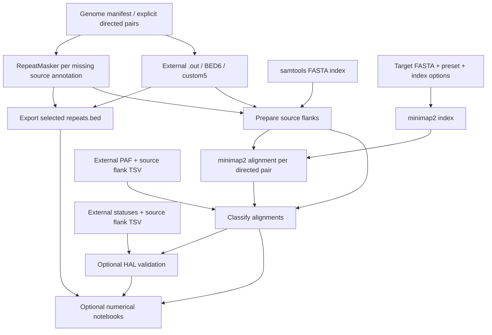

# ComRepka — Compare repeats

[Русская версия](../README.ru.md)

ComRepka is a comparative genomics pipeline for investigating repetitive-element loci across assembled genomes. It extracts repeat-flanking sequences from a source genome, aligns them to a target genome with minimap2, and classifies the resulting correspondence using the existing Python algorithms. Nextflow DSL2 coordinates the analysis and records its parameters and outputs.

The main workflow is **FASTA → RepeatMasker → repeat annotation and flanks → minimap2 → comparative status table**. Existing repeat annotations, flanks or PAF files can also be supplied. Genomes and directed source–target pairs are specified explicitly; the workflow is not restricted to humans, primates or LTR elements.

**Reproducibility:** A complete local workflow was recorded on a 20 kb positive-control fragment using samtools 1.22.1 and minimap2 2.22. The current environment specifies samtools 1.25 and minimap2 2.31. Historical outputs and tool versions remain documented in [Validation and reproducibility](#validation-and-reproducibility).

## Contents

- [Installation](#installation)
- [Quick start](#quick-start)
- [RepeatMasker and reference data](#repeatmasker-and-reference-data)
- [Full and partial execution](#full-and-partial-execution)
- [Inputs and formats](#inputs-and-formats)
- [Parameters](#parameters)
- [Outputs and interpretation](#outputs-and-interpretation)
- [SLURM and resources](#slurm-and-resources)
- [Notebooks](#notebooks)
- [Example datasets](#example-datasets)
- [Architecture](#architecture)
- [Validation and reproducibility](#validation-and-reproducibility)
- [License and citation](#license-and-citation)

## Installation

The documented platform is Linux x86_64 with Bash, Conda, **Nextflow 25.10.2** and **OpenJDK 17.0.18**. Java runs Nextflow; the scientific scripts are Python. Obtain Conda following the [Bioconda setup instructions](https://bioconda.github.io/). Nextflow can also be installed using its [official instructions](https://docs.seqera.io/nextflow/install/).

Run the commands below from the repository root. If Nextflow is already installed, keep that installation. To recreate the recorded launcher environment on Linux x86_64:

```bash
conda create --prefix "$PWD/.conda/nextflow" --file envs/locked/linux-64/nextflow.explicit.txt
conda activate "$PWD/.conda/nextflow"
```

The `local` and `slurm` profiles enable Conda. Nextflow creates and activates the environments required by the selected stages; they do not need to be installed one by one. Repeat databases are separate inputs, described below. [Nextflow Conda documentation](https://docs.seqera.io/nextflow/conda).

| Specification | Main tools | Role |
|---|---|---|
| [envs/core.yml](../envs/core.yml) | Python 3.12.2, pandas 2.2.1, NumPy 1.26.4, tqdm 4.65.0, samtools 1.25, minimap2 2.31 | Main processing environment |
| [envs/repeatmasker.yml](../envs/repeatmasker.yml) | RepeatMasker 4.2.3, HMMER 3.3.2; TRF supplied by package dependencies | Repeat annotation |
| [envs/analysis.yml](../envs/analysis.yml) | Python/pandas/NumPy, PyTables, JupyterLab, ipykernel | Notebook analysis |

A full run now uses **two process environments**: `core` for Python, samtools and minimap2, and `repeatmasker` for repeat annotation. `analysis` is optional and installed manually for notebooks; the Nextflow launcher is separate. Python and minimap tasks reference the same `envs/core.yml`, so Nextflow reuses one environment for both.

As of 2026-11-19, the latest releases are [samtools 1.25](https://github.com/samtools/samtools/releases/tag/1.25) and [minimap2 2.31](https://github.com/lh3/minimap2/releases/tag/v2.31). Their published Linux x86_64 Bioconda builds (`samtools-1.25-h9dcdb79_0`, `minimap2-2.31-h118bc1c_0`) both require `libzlib >=1.3.2,<2.0a0`, `libgcc >=14` and glibc >=2.17. The earlier conflicting zlib bounds are absent. Package metadata: [samtools](https://api.anaconda.org/release/bioconda/samtools/1.25), [minimap2](https://api.anaconda.org/release/bioconda/minimap2/2.31). The tool releases are pinned for reproducibility; their build strings and zlib are not manually pinned. Python package versions are unchanged. Use the versioned environment specifications together with the actual package resolution recorded for each analysis.

Package snapshots from the **2026-11-17 baseline** remain in [envs/locked/linux-64](../envs/locked/linux-64). `core.explicit.txt` and `minimap2.explicit.txt` describe the old separate environments and are retained only as historical evidence; the workflow does not use them. The Nextflow and RepeatMasker snapshots are also preserved. The configuration that re-enabled the old split has been removed. For the current combined core, use `envs/core.yml`; the historical explicit package lists describe earlier environments. Reference databases are separate inputs.

Use normal Conda activation to manage `PATH`; do not prepend base `bin` ahead of an active environment. If Nextflow is in a separate environment, invoke its executable by absolute path and, if necessary, set `NXF_JAVA_HOME` to that installation's Java directory. A shared `--conda_cache /absolute/path` can be reused between runs. No Apptainer image is included.

## Quick start

This small example uses an existing PAF and runs only the classifier. It needs no RepeatMasker, Dfam download or minimap2 execution:

```bash
nextflow run main.nf -profile local \
  --genomes examples/genomes.tsv --pairs examples/pairs.tsv \
  --from paf --until statuses --outdir results/example-paf
```

The output is `results/example-paf/pairs/genome_A__to__genome_B/statuses.tsv`. Compare the corresponding fields with [examples/expected/classification_summary.tsv](../examples/expected/classification_summary.tsv): two occupied loci and one locus without supplied hits. To prepare flanks from the supplied BED6 instead:

```bash
nextflow run main.nf -profile local \
  --genomes examples/genomes.tsv --pairs examples/pairs.tsv \
  --from annotation --until flanks --outdir results/example-flanks
```

These existing examples were used in the regression checks. The separate [full example](#example-datasets) includes the real sequence used to verify RepeatMasker and the complete workflow.

## RepeatMasker and reference data

Choose the **software installation** and the **reference data** independently. Dfam is never downloaded automatically by ComRepka. A run starting from BED, `.out`, flanks or PAF does not need RepeatMasker or a Dfam download. A species-based run from unannotated FASTA does need a compatible installed database.

### A. Set up from scratch

Nextflow installs RepeatMasker and its dependencies from `envs/repeatmasker.yml` when a genome needs annotation. No separate TRF installation or edit of `RepeatMaskerConfig.pm` is required for this Conda route.

If you already have compatible Dfam files, reuse them and skip downloading. Otherwise the following **optional download** prepares Dfam 3.9 for mammals. It retrieves root partition 0 and Mammalia partition 7 from the [versioned Dfam release](https://www.dfam.org/releases/Dfam_3.9/families/FamDB/). Other organisms require the partitions listed in the [release partition table](https://www.dfam.org/releases/Dfam_3.9/families/FamDB/README.txt). Do not mix releases or replace the versioned URL with `current` when reproducing these results.

Choose an absolute path without spaces outside the repository. These two archives total about 8.9 GB and require about 60.4 GB after decompression; keeping archives and extracted files requires about 70 GB before search caches. The block stops rather than overwriting existing database files.

```bash
export COMREPKA_LIBDIR=/absolute/path/to/Dfam_3.9/Libraries
(
  set -euo pipefail
  mkdir -p "$COMREPKA_LIBDIR/famdb"
  cd "$COMREPKA_LIBDIR/famdb"
  for part in 0 7; do
    archive="dfam39_full.${part}.h5.gz"
    test ! -e "$archive"
    test ! -e "${archive%.gz}"
    curl --fail --location --retry 3 \
      --output "$archive" \
      "https://www.dfam.org/releases/Dfam_3.9/families/FamDB/$archive"
    curl --fail --location --retry 3 \
      --output "$archive.md5" \
      "https://www.dfam.org/releases/Dfam_3.9/families/FamDB/$archive.md5"
    md5sum -c "$archive.md5"
    gzip -dk "$archive"
  done
)
```

Save the following as **`reference.yml`**, replacing the path. `-libdir` points to **`Libraries`**, the parent of `famdb`, not to an `.h5` file. RepeatMasker 4.2.3 uses the FamDB files there and builds its search caches on demand; keep this directory writable and keep different database releases in separate directories.

```yaml
rm_engine: hmmer
rm_sensitivity: s
rm_reference_id: Dfam-3.9_2025-03-10_curated_partitions-0-7
rm_extra_args: ["-libdir", "/absolute/path/to/Dfam_3.9/Libraries"]
```

No old personal RepeatMasker installation is needed for this route. The recorded full-workflow example used Dfam 3.9 partitions with a separate search-cache directory.

### B. Use an already configured RepeatMasker

No installation or download is needed if the required software and reference are already available. Select **one** of these configurations and save it as **`site.config`**.

For RepeatMasker in an existing **Conda environment**, specify the absolute environment prefix, not its name or `bin/RepeatMasker`:

```groovy
process {
    withName: 'COMPARISON:REPEATMASKER' {
        conda = '/absolute/path/to/existing/repeatmasker-env'
    }
}
```

Nextflow activates that environment for RepeatMasker and continues to manage the combined core environment for Python, samtools and minimap2. The prefix must contain a working RepeatMasker with its engine, TRF, Perl and FamDB dependencies.

For a configured installation **outside Conda**, disable Conda only for this process and supply the exact executable directory:

```groovy
process {
    withName: 'COMPARISON:REPEATMASKER' {
        conda = null
        beforeScript = '''
        export PATH="/absolute/path/to/RepeatMasker:/absolute/path/to/hmmer/bin:$PATH"
        test "$(command -v RepeatMasker)" = "/absolute/path/to/RepeatMasker/RepeatMasker"
        '''
    }
}
```

Replace both occurrences of the RepeatMasker directory and the engine directory. The selected installation must already work in this shell, including Perl/Python dependencies and its configured TRF executable. If it requires an environment module, use the site's normal `module load` command in `beforeScript`. `TRF.pm` is a Perl module, not the native TRF program. Do not set `TRF_PRGM` to that module or globally disable Conda for the other pipeline stages.

The existing installation can use its configured library with `rm_extra_args: []`. Alternatively, point `reference.yml` to its existing `Libraries` directory using the same `-libdir` setting as in route A. Set `rm_reference_id` to the **actual** release/partition selection. A value in this field records identity and affects caching; it does not download or inspect the database. Add `-c site.config` to the run command. These external-installation overrides use standard Nextflow configuration; provide paths and libraries matching your installation.

### Common settings and verification

The verified configuration is RepeatMasker **4.2.3**, **HMMER 3.3.2**, `-engine hmmer -s -align`, Dfam **3.9 / 2025-03-10**, partitions **0 + 7**, curated families. Native TRF in the tested Conda environment is **4.10.0rc2**. `species` comes from each genome's manifest row; the full example uses `Homo sapiens`. Historical commands used `-pa 48`; this is distinct from the workflow's default CPU allocation (see resources).

`rm_library` selects an external custom library instead of `species`. Its format must match the chosen engine (HMM models for HMMER; nucleotide consensus FASTA for RMBlast). This alternative may require engine-specific setup and must not be used as an implicit replacement for the Dfam/HMMER configuration.

After a run, inspect `genomes/<id>/repeatmasker/software_versions.txt` and `run.log` for the actual version, engine and database; inspect provenance `parameters.json` for effective parameters. For a configured installation, record the environment or site configuration alongside the results. Do not overwrite a database in place and expect `-resume` to detect the change automatically.

## Full and partial execution

For a full analysis, supply your own `genomes.tsv` and `pairs.tsv`. Leave annotation fields empty for genomes that need RepeatMasker. With `reference.yml` prepared using route A:

```bash
nextflow run main.nf -profile local -params-file reference.yml \
  --genomes genomes.tsv --pairs pairs.tsv \
  --from genome --until statuses --outdir results/study-001
```

For route B, add `-c site.config` to that command; this selects the existing RepeatMasker while the other processes share `envs/core.yml`. For SLURM, replace `-profile local` with `-profile slurm` and supply the site resource settings.

The original `examples/genomes.tsv` already supplies BED: `--from genome` with that manifest **reuses annotation** and does not test RepeatMasker. Use `examples/full` for the full FASTA route. Target annotations are unnecessary for the core classifier; `--annotate_targets true` at a `genome` or `annotation` start also prepares them for downstream matching. List all desired directed comparisons explicitly; self-pairs are rejected.

| Start (`--from`) | Required existing inputs | Subsequent work |
|---|---|---|
| `genome` | Source FASTA and species/reference; target FASTA if aligning | Missing annotations, BED export, index, flanks, alignment, classification |
| `annotation` | Source `.out`, BED6 or `custom5`; source FASTA for flanks; target FASTA if aligning | BED export and requested later stages |
| `flanks` | Source flank FASTA and TSV; target FASTA | Alignment and classification |
| `paf` | PAF per pair and source flank TSV | Classification; genomic FASTA unnecessary |
| `statuses` | Status TSV per pair and source flank TSV | Optional HAL; use `--until validation` |

End stages are `annotation`, `flanks`, `paf`, `statuses` and `validation`. The selected interval must contain work; equal start/end `flanks`, `paf` or `statuses` are rejected. Intermediate paths in a manifest do not select a later stage by themselves: set `--from`. At `genome`, existing annotations can be mixed with genomes needing annotation. At `paf` or `statuses`, all selected pairs must supply that intermediate.

To continue a run, repeat its command with **`-resume`**, retaining the launch directory's `.nextflow/cache` and the `work/` directory. This reuses matching tasks, not arbitrary published files. Starting from external results uses `--from` and manifest fields instead. [Nextflow cache documentation](https://docs.seqera.io/nextflow/cache-and-resume/).

The Python scripts also remain independently executable:

```bash
python bin/prepare_repeat_annotation.py --input repeats.out --format rm_out \
  --target-groups LTR --output repeats.bed
samtools faidx genome.fa
python bin/prepare_flanks.py --bed repeats.bed --bed-format bed6 \
  --genome-fasta genome.fa --out-fasta flanks.fa --out-table flanks.tsv \
  --out-targets targets.tsv
python bin/classify_alignments.py --paf alignments.paf --flank-table flanks.tsv \
  --out-table statuses.tsv --mode stream
```

These are BED-route commands. For equivalence with the full RepeatMasker route, pass the complete `.out` to `prepare_flanks.py --rm-out repeats.out` with the same target selectors; a filtered BED does not retain the complete repeat mask. Standalone `samtools faidx` creates an adjacent `.fai`; use a writable FASTA copy if needed. Nextflow builds the index in its work directory.

## Inputs and formats

Manifests are UTF-8 TSV with a header, literal tab delimiters, empty optional fields, no embedded tabs/newlines and no CSV quoting. Lines starting with `#` and empty lines are ignored by the workflow; for notebook compatibility omit such lines. **Data paths are relative to the manifest that contains them**, or absolute. CLI/parameter-file paths are relative to the launch directory. All supplied paths must exist, including optional fields that are populated. Do not add credentials to manifests or parameter files: they are recorded as provenance.

`examples/genomes.tsv` documents these columns:

| Field | Meaning |
|---|---|
| `genome_id` | Unique identifier matching `[A-Za-z][A-Za-z0-9_]*` |
| `fasta` | Uncompressed genomic FASTA; contig IDs must match annotation or the chromosome map |
| `species` | RepeatMasker species selector for this genome; unnecessary with a custom library or existing annotation |
| `annotation` | One external repeat annotation file |
| `annotation_format` | Explicitly `rm_out`, `bed6` or `custom5` |
| `flank_fasta` | Existing queries in the query-name convention below |
| `flank_table` | Existing source-coordinate TSV corresponding to those queries |
| `chrom_map` | Optional JSON object mapping annotation contig names to FASTA names |

`examples/pairs.tsv` documents:

| Field | Meaning |
|---|---|
| `source`, `target` | Genome IDs; direction is source queries → target genome; duplicate/self pairs are rejected |
| `preset` | minimap2 preset for this pair; empty uses `minimap_preset` |
| `paf` | External PAF used at `--from paf` |
| `statuses` | External classifier TSV used at `--from statuses` |
| `hal` | Optional HAL file for validation |
| `hal_source`, `hal_target` | Exact names inside the HAL alignment |
| `hal_source_chrom_map`, `hal_target_chrom_map` | Optional JSON contig maps from source/predicted target names to HAL names |

A chromosome map is a JSON object such as `{"old_contig": "new_contig"}`. Mapping names does not perform coordinate lift-over. Assembly versions, sequence content and coordinate systems must already agree.

**BED6** is `chrom start end name score strand`, tab-separated and without a header. Coordinates are 0-based half-open, `name` is the repeat name, `score` is an integer 0–1000 (exported as `0`, unused in calculations), and `strand` is `+`, `-` or `.`. This follows the [UCSC BED specification](https://genome.ucsc.edu/FAQ/FAQformat.html#format1). Exactly six columns are accepted; BED3/BED12 require explicit conversion first. Blank lines, comments, `track` and `browser` lines are skipped. Invalid intervals and fields are rejected. Nonempty `name` is required; `.` is retained literally and provides no useful repeat identity.

The historical five-column format is **not BED6**: `chrom start end strand rep_name`. Select `custom5` explicitly; it is never auto-detected. Both formats use the same 0-based half-open coordinates. The converter exports BED6 and does not preserve original score values, since scores have no role in this pipeline. Class/family and RepeatMasker ID are absent in BED and remain empty in `targets.tsv`.

For **external BED**, every supplied row is a target and every interval contributes to the mask used by NRT extraction. `target_groups` and `target_repeats` are ignored. Supply one BED per genome, not separate target/mask files. A prefiltered LTR-only BED means “non-repeat” relative to that supplied annotation, not necessarily repeat-free genomic sequence. This can produce different left flanks than a complete `.out`.

For **RepeatMasker `.out`**, the flank parser uses numeric-leading records with at least 15 fields: query contig field 5, begin/end fields 6/7, strand field 9, repeat name field 10, class/family field 11, trailing numeric repeat ID (ignoring a trailing `*`). Begin is converted from 1-based inclusive to `begin - 1`; end is retained. `C`/`-` become minus in the flank parser. All parsed intervals on known FASTA contigs contribute to the mask; only selected records become targets. Unknown contigs are skipped by the inherited flank parser: inspect its parsed/retained counts and supply a correct map. BED export itself does not check FASTA membership.

Flank target selection matches an exact repeat name OR exact class/family OR the class prefix before `/`; default is `LTR`. Set `target_groups` to an empty string for name-only selection, or `all` to select all groups. The notebook-derived BED exporter retains class-prefix matching (`class == target` or `class.startswith(target + '/')`), accepts `+`/`C` strands, and uses the same coordinate conversion. For ordinary LTR/subclass selection these agree. Nested subclass prefixes and unusual strand tokens should be checked explicitly instead of assuming both inherited parsers are identical.

FASTA must be uncompressed, with stable unique contig identifiers and conventional line wrapping; the Python reader uses a samtools `.fai`. Generated query names are:

```text
group_id|chrom|left|L=...|left:start-end|block:start-end|nrt:...|nrt_len:...|overhang:...
group_id|chrom|right|L=...|right:start-end|block:start-end|overhang:...
```

`group_id = chrom:start-end` identifies source repeat coordinates. Left/right mean genomic left/right regardless of annotated repeat strand; sequences are not reverse-complemented on the source minus strand. Source intervals sharing coordinates cannot be distinguished by this identifier; duplicate targets are rejected instead of silently merged. Avoid whitespace and `|` in contig IDs.

PAF requires the standard 12 fields. `tp`, `de` and other tags are parsed when present; `cg`/`cs` are emitted by the default minimap2 command but are not used by the classifier to inspect per-base overhang alignment. Query names must retain `group_id` and literal `left`/`right` tokens. In `stream` mode all records of each group must be contiguous. A reappearing group now raises an error; use `classify_mode: collect` for unordered PAF, allowing more memory. Unknown query naming/unknown groups retain the original skip behavior. Empty PAF is valid and yields `no_flank_hits` for all loaded loci; an empty flank table is rejected.

## Parameters

All effective defaults are in `nextflow.config`; `conf/params.example.yml` contains every exposed parameter and can be passed with `-params-file`. Edit a copy for a study. A CLI parameter uses underscores, for example `--flank_len 5000`; the standalone Python CLI uses hyphens, for example `--flank-len 5000`.

| Parameters | Defaults / meaning |
|---|---|
| `from`, `until`, `outdir`, `annotate_targets` | `genome`, `statuses`, `results`, `false` |
| `rm_engine`, `rm_sensitivity` | `hmmer`, `s`; sensitivity choices `default`, `s`, `q`, `qq` |
| `rm_library` | Optional engine-compatible custom repeat library; replaces per-genome species selection |
| `rm_reference_id` | Declared library identity; default `Dfam-3.9_2025-03-10_curated`; update to actual release/partition/checksum |
| `rm_extra_args` | List of additional compatible RepeatMasker arguments; no shell command strings |
| `target_groups`, `target_repeats` | `LTR`, empty; comma-separated selectors for `.out` only |
| `flank_len`, `nrt_len`, `overhang_len` | `5000`, `500`, `50` bp |
| `soft_mask`, `target_near_keep`, `repeat_end_keep` | `false`, `500`, `50` bp |
| `max_groups` | `0`, no target limit; nonzero is a deliberate debug subset |
| `minimap_preset` | `asm10`; pair `preset` overrides; historical study also used `asm20` |
| `minimap_secondary`, `minimap_N`, `minimap_p` | `yes`, `20`, `0.8`; `-c --cs=long` always requested |
| `minimap_index_args` | List of indexing options, e.g. `["-k", "19", "-w", "19"]`; also passed when mapping |
| `minimap_extra_args` | Compatible mapping options; put `-k`, `-w`, `-H`, `-I` in `minimap_index_args` |
| `hal_liftover`, `hal_version` | `halLiftover`, `UNRECORDED`; configure executable/version explicitly before HAL use |
| `hal_anchor_len`, `hal_anchor_offsets` | `300`, `"0,400"` |
| `hal_min_pred_recall`, `hal_alt_iou_threshold`, `hal_len_ratio_max` | `0.95`, `0.2`, `2.0` |
| `hal_batch_size` | `200000` anchor requests per external call; not a bound on total Python memory |

Changing engines/presets is supported as configuration, but the scientific suitability and required dependencies are not automatically inferred from species. The packaged RepeatMasker environment targets HMMER. Custom-library searches or another engine may require different setup and result comparison. Extra-argument lists are shell-quoted token by token. Workflow-controlled output/thread/reference options and SAM output are rejected where detected; do not use extras to change output format or filenames. `--split-prefix` is not supported. For very large minimap2 targets, choose an appropriate `-I` index batch size and check that a multi-part index has not changed mapping/stream assumptions.

Classifier settings map directly to the copied script:

| Parameter | Default | Meaning |
|---|---|---|
| `classify_mode` | `stream` | Group-contiguous PAF; `collect` accepts arbitrary order |
| `classify_max_tsd` | 50 | Largest overlap allowed for `empty_with_TSD` |
| `classify_max_empty_gap` | 50 | Largest positive gap for `empty_without_TSD` |
| `classify_length_tolerance_bp` | 100 | Absolute occupied-length tolerance |
| `classify_length_tolerance_frac` | 0.10 | Fractional tolerance; maximum of absolute and fractional used |
| `classify_max_pair_distance` | 10000 | Distance limit, raised to repeat length + absolute tolerance if necessary |
| `classify_min_identity` | 0.80 | PAF matches / alignment block length |
| `classify_min_query_cover` | 0.20 | Aligned query span / query length |
| `classify_min_mapq` | 0 | Alignment MAPQ filter |
| `classify_primary_only` | false | Filter non-primary `tp` tags; records without `tp` retain inherited acceptance |
| `classify_max_hits_per_side` | 20 | Retained candidates per flank before pairing; 0 disables pruning |
| `classify_min_overhang_aligned` | 45 | Required aligned query-span coverage inside the overhang, capped by actual overhang length |
| `classify_overhang_edge_slop` | 5 | Allowed clipping at the repeat-proximal query edge |
| `classify_ambiguous_score_delta` | 5.0 | Best versus second pair score difference threshold |
| `classify_high_identity`, `classify_low_identity` | 0.90, 0.85 | Confidence thresholds |
| `classify_high_query_cover`, `classify_low_query_cover` | 0.50, 0.30 | Confidence thresholds |
| `classify_high_mapq` | -1 | Disabled MAPQ confidence threshold; nonnegative values enable it |

## Outputs and interpretation

Use a distinct `outdir` for each study/configuration. Nextflow publishes copies; downstream processes consume work outputs through channels, not files that may still be publishing.

```text
results/
  genomes/<genome_id>/
    repeatmasker/               # Only when RepeatMasker ran
    repeats.bed                # Selected .out records or all external BED rows
    genome.fa.fai
    samtools.version.txt
    annotation.python_packages.txt
    flanks.python_packages.txt
    flanks.fa
    flanks.tsv
    targets.tsv
    indices/<preset>/minimap2.version.txt
  pairs/<source>__to__<target>/
    alignments.paf
    minimap2.version.txt
    statuses.tsv
    python_packages.txt
  validation/<source>__to__<target>/
    hal_statuses.tsv
    hal_ambiguous.tsv
    hal_disagree.tsv
    hal_other_contigs.tsv
    hal_unsupported.tsv
    hal_version.txt
  provenance/
    <timestamp>/genomes.tsv
    <timestamp>/pairs.tsv
    <timestamp>/parameters.json
    <timestamp>/run.txt
    trace-<timestamp>.tsv
    report-<timestamp>.html
    timeline-<timestamp>.html
```

Only requested/generated artifacts appear. Imported intermediates stay at their original locations and are not republished. `.mmi` indices remain in `work/` for caching; no large genome copies are published. Provenance manifest copies retain their original relative paths; use `run.txt` to resolve their original locations rather than treating the copied manifests as relocatable datasets. Nextflow work directories are not automatically deleted.

`flanks.tsv` has 12 columns: `group_id`, `chrom`, `group_start`, `group_end`, `blocked_start`, `blocked_end`, `left_flank_start`, `left_flank_end`, `right_flank_start`, `right_flank_end`, `n_repeats_inside`, `repeat_ids_inside`. There is one repeat per group; `n_repeats_inside=1` and `repeat_ids_inside` is its name. All coordinates are source-genome 0-based half-open, including repeat overhangs.

`targets.tsv` contains `group_id`, `chrom`, `repeat_start`, `repeat_end`, `repeat_strand`, `repeat_name`, `class_family`, `rm_id`. BED inputs leave the last two fields empty.

`statuses.tsv` retains all **54 columns** of the original classifier. Column groups:

- Locus: `group_id`, `ref_chrom`, `ref_start`, `ref_end`, `repeat_len`, `repeat_ids_inside`.
- Decision: `status`, `best_candidate_status`, `confidence`, `low_confidence`, `confidence_reasons`, `status_reason`.
- Candidate counts/scores: `left_raw_hits`, `right_raw_hits`, `left_filtered_hits`, `right_filtered_hits`, `candidate_pair_count`, `best_pair_score`, `second_pair_score`.
- Target: `target_contig`, `target_strand`, `left_target_start`, `left_target_end`, `right_target_start`, `right_target_end`.
- Query: `left_query_start`, `left_query_end`, `right_query_start`, `right_query_end`, `left_query_len`, `right_query_len`.
- Alignment evidence: `left_identity`, `right_identity`, `left_query_cover`, `right_query_cover`, `left_mapq`, `right_mapq`, `left_tp`, `right_tp`, `left_divergence`, `right_divergence`.
- Geometry: `left_overhang_len`, `right_overhang_len`, `left_overhang_supported`, `right_overhang_supported`, `delta`, `observed_interval_len`, `length_delta`, `pair_span`, `tsd_len`, `tsd_target_start`, `tsd_target_end`.
- Selected queries: `left_qname`, `right_qname`.

Missing values remain empty TSV fields; do not convert them to genomic coordinate 0. Input source/target identity is maintained by manifests, workflow metadata and pair directories, not extra columns added to the scientific table.

The classifier selects pairs on the same target contig/strand with compatible order. For `+`, `delta = right_target_start - left_target_end`; for `-`, `delta = left_target_start - right_target_end`. `observed_interval_len = delta + left_overhang_len + right_overhang_len`. This is an inferred interval length, not direct target repeat annotation.

| Status | Interpretation under the inherited heuristic |
|---|---|
| `occupied_expected_length` | Both query overhangs supported and inferred length within tolerance |
| `occupied_different_length` | Both overhangs supported, length outside tolerance |
| `empty_with_TSD` | Neither overhang supported, short target overlap; zero overlap is included by the original rule |
| `empty_without_TSD` | Neither overhang supported, small positive gap |
| `local_indel_or_rearranged` | One overhang supported or other local geometry |
| `ambiguous_lr_pair` | Top two candidate pair scores are too close |
| `no_flank_hits`, `no_left_hit`, `no_right_hit` | Missing filtered alignment evidence |
| `no_valid_lr_pair` | No compatible contig/strand/order pair |
| `discordant_pair` | Compatible order exists but exceeds the distance limit |

`confidence=high` is not proof of unique orthology: secondary alignments and MAPQ 0 can receive high confidence with the defaults. Pair selection uses ranking/pruning and stable input-order tie breaking. Overhang support uses query spans rather than CIGAR base-level evidence. These inherited scientific choices are unchanged.

HAL reports `HAL_CONFIRMED_UNIQUE`, `HAL_AMBIGUOUS`, `HAL_DISAGREE`, `HAL_UNSUPPORTED` and supporting candidate tables. Its anchors lie inside the actual source flanks; its source reference gap is `max(0, right_flank_start - left_flank_end)`, which excludes both overhangs. Hit-pair order is checked, but BED4 hits do not retain individual hit strand. Missing or zero-length predictions can be unsupported. These labels describe this validation heuristic and alignment, not independent biological ground truth.

## SLURM and resources

The SLURM profile requires cluster-specific partition, account and resource settings.

Use a shared filesystem for inputs, repository, Conda cache and work directories accessible to submission and compute nodes. No cluster node name is hardcoded. Set partition/account and resource estimates in your parameter file:

```yaml
slurm_partition: cpu
slurm_account: your_account
max_jobs: 2
rm_cpus: 48
rm_memory: "350 GB"
rm_time: "7d"
minimap_cpus: 64
minimap_memory: "500 GB"
minimap_time: "7d"
python_memory: "32 GB"
python_time: "24h"
hal_memory: "32 GB"
hal_time: "24h"
conda_cache: /shared/comrepka/conda
```

These large numbers reproduce historical resource requests as examples, not measured minima. Local defaults are deliberately modest: RepeatMasker 2 CPUs/16 GB/24h, minimap2 2 CPUs/8 GB/24h, Python 1 CPU/8 GB/4h, HAL 1 CPU/16 GB/24h, `max_jobs=2`. Adjust to actual data before running whole genomes. A historical minimap2 log showed about 23.9 GB peak RSS for one particular comparison; this cannot be generalized.

For the inspected HMMER configuration, the workflow calculates RepeatMasker `-pa = floor(rm_cpus / 2)`, at least 1, to avoid asking for two cores per batch while allocating one. Thus 48 allocated CPUs give `-pa 24`; reproducing historical `-pa 48` requires at least 96 allocated CPUs. Other engines use `-pa = rm_cpus` and require engine-specific verification. Python scientific processing remains single-threaded. `max_jobs` bounds queue submission/process concurrency; it is not a shared global RAM budget. Choose it with total local RAM in mind. See [Nextflow executors](https://docs.seqera.io/nextflow/executor/).

## Notebooks

To prepare the optional notebook analysis environment:

```bash
conda env create -f envs/analysis.yml
conda activate comrepka-analysis
jupyter lab notebooks/
```

No notebook is an automatic Nextflow step. Open it in the analysis environment, edit its first configuration cells, then execute cells in order manually. Kernel outputs and execution counts were cleared. No plotting, GC analysis, species-specific tree or ancestral-state inference is included.

| Notebook | Inputs and role | Outputs |
|---|---|---|
| `pairwise_statistics.ipynb` | Pair/genome manifests, full status TSVs; optional target BED and HAL summaries | `status_counts.tsv`, `confidence_counts.tsv`; optional per-pair `annotation_matches.tsv`, `hal_by_group.tsv`, `hal_counts.tsv` |
| `prepare_comparison_matrix.ipynb` | Optional processing for many directed comparisons; selected status columns and target repeat BED | `comparison.h5`: `transfers` and `repeat_annotation_status_matrix` |
| `multigenome_statistics.ipynb` | Prepared HDF5 matrix | `annotation_status_counts.tsv`, `retained_target_counts.tsv` |

Notebook defaults refer to `results/`; when using the quick-start `results/example-paf`, change `RESULTS_DIR` accordingly. A target BED is necessary only when matching target repeats. `MATCH_REPEATS=False` and `INCLUDE_HAL=False` initially. HAL rows are joined by `group_id`, never by row position. Duplicate locus keys cause an explicit error instead of silently dropping records.

`annotation_matches.tsv` stores `n_matched_repeats=-1` and JSON `null` index/name lists for loci not selected for matching; `0` with empty lists means matching found no repeat. Matched indices refer to zero-based rows of the target BED read by the notebook.

Repeat matching considers five transferable statuses: both `occupied_*`, both `empty_*`, and `local_indel_or_rearranged`. At gaps `[50,55,65,75,85,100]`, it requires full containment of a target repeat and stops at the first gap with any match. Repeat-name matching is exact. The pairwise scenario keeps the original ordered boundaries without min/max normalization; the matrix scenario normalizes them. This difference is preserved and can produce different results for overlapping/reversed inner boundaries.

The six matrix states are `not_transferred`, `transferred_no_repeat`, `transferred_one_repeat_same_name`, `transferred_one_repeat_different_name`, `transferred_multiple_repeats_with_source_name`, `transferred_multiple_repeats_without_source_name`. `self_no_transfer` marks the diagonal. `not_compared` denotes missing comparisons/loci, never an absence call. Metadata for loci present in only some pairs is retained; conflicting metadata raises an error.

HDF5 is a derived analysis cache, not a lossless replacement for the 54-column TSV. It retains 13 classification input columns plus source/target metadata, omitting confidence and many diagnostics. Keep original TSVs. Existing HDF5 is not silently reused/rebuilt: set `REBUILD=True` explicitly to rebuild. A `.building.h5` file is retained after a failed build, and the previous completed file is replaced only after successful construction. Fixed HDF string capacities (e.g. 128 for `group_id`, 256 for repeat names) cause errors on oversized values rather than intended truncation; adjust them explicitly if needed. Although raw import and statistics are chunked, target repeat indices and one pair/source matrix can still require substantial RAM.

## Example datasets

### Synthetic interface and regression examples

The existing `examples/data` files contain deterministic synthetic genomes (18 kb and 40 kb), BED6, equivalent `custom5`, a synthetic RepeatMasker-format `.out`, flank FASTA/TSV and a hand-authored PAF. The generation seed is `20261110`. Matching blocks were copied forward/reverse into the target. These data are not real assemblies or repeat-library detections.

| Locus | Expected left flank from BED | Expected right flank from BED | PAF classification |
|---|---|---|---|
| `chrA:6000-6100` | `[1000,6050)` | `[6050,11100)` | `occupied_expected_length`, high, length 100 |
| `chrA:12000-12100` | `[7000,12050)` | `[12050,17100)` | `occupied_expected_length`, high, length 100 |
| `chrA:17000-17100` | `[12100,17050)` | `[17050,18000)` | `no_flank_hits`, low |

Expected fields were initially derived by hand and subsequently checked during regression testing. Existing source and adapted-script outputs agree on the saved synthetic, masking, real-PAF-subset, empty-PAF and BED-chain cases. The synthetic `.out` additionally masks a LINE interval `[2000,2100)`, changing the first left flank start to 2100. This deliberately differs from the LTR-only BED result.

These examples remain useful for partial execution. RepeatMasker may find no repeats in their synthetic DNA, and minimap2 need not reproduce the hand-authored PAF.

### Complete workflow example

[examples/full](../examples/full) contains the **already tested** 20 kb fragment of assembly `GCF_009914755.1` (T2T-CHM13v2.0), contig `NC_060925.1`, interval `[20000,40000)` (1-based inclusive `20001–40000`). The source header is `rm_test`. The target contains the identical sequence with header `target_test`, providing a technical positive control rather than a second biological genome.

The directory includes portable manifests, [params.json](../examples/full/params.json), original input files, saved expected outputs and [provenance.json](../examples/full/provenance.json) with accessions, coordinates, reference identity and file SHA-256 values. Expected outputs were copied from the successful run; no new sequence or scientific output was generated during packaging.

After preparing RepeatMasker and `reference.yml` using route A or B, run from the repository root:

```bash
nextflow run main.nf -profile local -params-file reference.yml \
  --genomes examples/full/genomes.tsv --pairs examples/full/pairs.tsv \
  --from genome --until statuses --outdir results/example-full
```

For a configured existing installation, add `-c site.config`; if its default library is correct, keep `rm_extra_args: []` and the actual `rm_reference_id` in `reference.yml`. The saved `expected/` files are the historical baseline produced with samtools 1.22.1, minimap2 2.22 and Dfam 3.9 partitions 0 + 7. The current tool versions are configured in `envs/core.yml`; retain the saved example outputs as a version-specific historical baseline. `params.json` records the example parameters; supply the local library path separately in `reference.yml`.

Outputs appear under `results/example-full/genomes/source_genome/` and `results/example-full/pairs/source_genome__to__target_genome/`. The previous seven-process check produced 32 RepeatMasker records, 2 selected repeat loci, 4 flank queries and 2 status rows. BED, flank files, targets, PAF and status TSV matched direct execution with those previous tool versions. The saved files have not been regenerated or relabelled as results of the updated tools. Compare RepeatMasker numeric records after whitespace normalization; headers may differ between installations. The full example has no target annotation because `annotate_targets` is false.

A short input does not imply a small database download. Reuse existing Dfam data where possible; the full reference is not included in Git.

## Architecture



Source flank generation is shared by all its target pairs. Target indices are shared within each `(target,preset)` group; explicit indexing arguments and target FASTA enter the Nextflow task cache. Different runs with changed index options create different cached tasks; published version files may share names, so use separate output directories. Pair metadata is carried explicitly through keyed channels. Independent sources, indices and pairs can run concurrently after their inputs become available.

```text
ComRepka/
  README.md
  README.ru.md
  main.nf
  nextflow.config
  conf/{base,local,slurm}.config
  conf/params.example.yml
  workflows/comparison.nf
  modules/{repeatmasker,fasta_index,prepare_repeat_annotation,prepare_flanks,
           minimap_index,minimap_align,classify_alignments,validate_hal}.nf
  bin/{prepare_flanks,classify_alignments,validate_hal,
       prepare_repeat_annotation,annotation_io}.py
  notebooks/{pairwise_statistics,prepare_comparison_matrix,multigenome_statistics}.ipynb
  envs/{core,repeatmasker,analysis}.yml
  envs/locked/linux-64/*.explicit.txt
  examples/{genomes,pairs}.tsv
  examples/data/
  examples/expected/
  examples/full/{input,expected}/
  examples/full/{genomes.tsv,pairs.tsv,params.json,provenance.json}
  .gitignore
```

No Python package, test framework, CI workflow or additional configuration framework is required for this first migration. No whole-genome datasets, old batch wrapper or site-specific SLURM scripts were copied. The previously validated 20 kb fragment is the only real sequence example. Their useful invocation settings were converted into configurable parameters. All documentation is deliberately in these two language files; code comments are English only.

## Validation and reproducibility

Changes in adapted scientific scripts are limited to neutral naming, BED input/normalization, portable paths/options, default LTR selection, detection of duplicate locus keys/out-of-bounds target intervals, and rejection of non-contiguous groups in stream mode. The flank interval functions, soft-mask computation, pair scoring/geometry, confidence decisions, output columns and HAL interpretation were preserved. Static AST comparison confirmed unchanged computational bodies for 11 flank helper functions, 17 classifier functions and 15 HAL helper functions; the complete 54-column classifier schema is identical. The HAL executable can now be selected explicitly. The original no-target-selection error is replaced by the agreed LTR default; pass explicit parameters when comparing old runs.

Notebooks retain the two distinct repeat-matching algorithms, but replace hardcoded species/file discovery with manifests, positional HAL assignment with key joins, and silent duplicate dropping with errors. Matrix metadata for partially overlapping locus sets is retained. Numerical exports replace figures and phylogenetic analyses. These are documented integration/data-handling changes; no new biological validation is claimed.

Baseline SHA-256 values of the three source implementations before adaptation, recorded under their new component names:

| Component | Baseline SHA-256 |
|---|---|
| `prepare_flanks.py` | `c6a2b0f2d4497d0a0c3f201394c8b4b4f83ab649e067a1e3fc3b1e07b89f943f` |
| `classify_alignments.py` | `97c3afe9ea8df3344b50a42c225a10405d8c050aea66ffefd8041a34b463dfc6` |
| `validate_hal.py` | `68475bb1c737a4907518a5c826b6d628e862c7f616f8ad8b573d8370a36e737c` |

Validation of the previous environment configuration (samtools 1.22.1, minimap2 2.22):

| Check | Result and scope |
|---|---|
| Python regression | Saved original/adapted outputs agree; includes synthetic inputs, repeat masking, a real PAF subset, empty PAF, BED6/custom5 and stream/collect cases |
| Partial Nextflow runs and minimap2 | Previously completed by the project owner; parameters and directed pairs exercised |
| Clean local FASTA → flanks | Nextflow created the required Conda environments; all four processes completed; outputs matched direct execution |
| Resume of that four-process run | All tasks `CACHED`, task hashes unchanged, verified outputs preserved |
| Clean local FASTA → statuses | All seven processes completed on the 20 kb positive control; Nextflow created all three process environments; results matched the baseline/direct execution |
| Historical package recording | Previous installed Conda package builds and hashes saved; the old core/minimap2 snapshots are not selected by the current workflow |
| Combined core with samtools 1.25 / minimap2 2.31 | Versions specified in `envs/core.yml`; historical package snapshots kept separately |
| SLURM, HAL, notebooks, analysis environment | Execution instructions and configuration are provided in their respective sections |
| Whole-genome or distinct-species biological validation | Depends on the dataset and study-specific biological controls |

The archived example preserves results from the earlier tool versions and selected regression cases. The original Python scientific algorithms and process commands remain unchanged; environment versions and selection are documented separately.

The [minimap2 2.31 release notes](https://github.com/lh3/minimap2/releases/tag/v2.31) explicitly report that fixes can change alignments. Keep the historical baseline intact and record any version-dependent differences in separately generated outputs.

For each real study, record genome accessions/versions and sequence checksums, complete annotation provenance, reference library release/partitions/checksums, tool build versions, parameter files and pair direction. The workflow records manifests, effective parameters, commands, runtime version files and Nextflow reports. It does not hash multi-gigabyte inputs automatically; Nextflow's ordinary file cache signature uses metadata and does not prove content identity. A declared `rm_reference_id` affects caching but cannot check an installed external database. Update it when the actual database changes and keep its checksum separately. Keep `work/` and `.nextflow/cache` while resuming; archive selected final outputs and provenance after validation.

The original software algorithms and source project remain separate from this repository. Repeat checks when relevant inputs, tool versions, or the implementation change. Whole-genome analyses may take weeks and are not required simply to publish the source.

## License and citation

License selection, authorship metadata, `LICENSE`, `CITATION.cff`, a public repository URL and a release tag are pending the owners' decisions. No license or DOI is implied. Optional Zenodo archiving follows a published release. Cite the exact ComRepka revision, genome and repeat-library releases, parameters, and the external tools according to their citation instructions.

Before publication, review the intended file list. Include source, configuration, both READMEs, package snapshots and small examples. Exclude environments, `work/`, `.nextflow/`, study results, Dfam, large genomes, personal site configurations and credentials. `.gitignore` covers the standard local directories; it does not replace review of files stored elsewhere or previously tracked files. Publish only after reviewing the files staged for Git.
